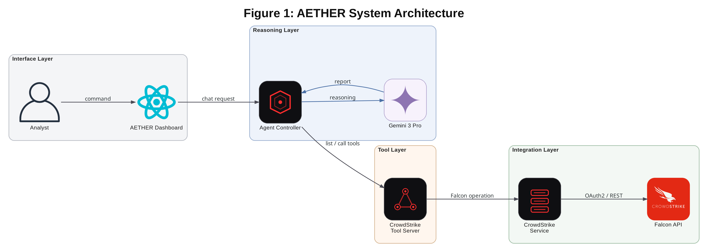

<h1 align="center">
  
  AETHER
</h1>

<p align="center"><strong>Investigate Falcon incidents and contain hosts with Gemini 3 Pro</strong></p>

AETHER is a browser-based security analyst console that pairs **Google Gemini 3 Pro** with live **CrowdStrike Falcon** telemetry. You describe an investigation in natural language; the agent discovers and calls Falcon operations through an in-process, MCP-style tool interface; and the dashboard shows the tool activity, the written analysis, and — for host isolation — an explicit approve-or-deny step.

The application is a single-page client. There is no backend in this repository. The Gemini API key is provided at dev/build time, Falcon credentials are entered in Settings and stored in the browser, and Falcon API calls are made from the page (typically through a CORS proxy). The GitHub repository is [Falcon-Intelligence](https://github.com/ritvikindupuri/Falcon-Intelligence); the product name in the UI is AETHER.

---

## Key Features

- **Natural-language investigations** — Ask the agent to triage incidents, inspect hosts, or pull detections. Gemini 3 Pro can chain multiple Falcon calls in one turn before it writes a report.
- **Falcon tool surface** — The in-process CrowdStrike tool server exposes fleet statistics, incident listing, device details, detections, host containment, and lifting containment.
- **Analyst-approved containment** — If the model requests `contain_host`, the UI pauses on an authorization card. The isolation call runs only after you click **Authorize Action**. **Deny** returns that decision to the model without isolating the host.
- **Visible tool activity** — Each tool call is rendered as a card with the function name, parameters, and JSON result so you can see what the agent actually requested and received.
- **Structured reports** — Model replies are rendered as Markdown. The system prompt asks for Analysis, Risk, and Response sections. MITRE technique IDs such as `T1059` are highlighted when they appear in inline code.
- **Fleet status sidebar** — On wide viewports, the sidebar shows **Critical** and **Open** incident counts, refreshed from Falcon every 30 seconds.
- **Critical-incident alerts** — After a baseline poll, an increase in the critical-incident count inserts a system alert into the chat. The alert does not start an investigation on its own.
- **Tactical shortcuts** — **Start Triage** and **Host Audit** send predefined prompts into the same chat pipeline.
- **Connection settings** — The Settings modal collects a CORS proxy URL, Falcon Client ID, and Client Secret, then validates them with an OAuth2 token request before saving.

---

## System Architecture

<p align="center">
  
</p>
<p align="center"><b>Figure 1: AETHER System Architecture</b></p>

1. The analyst types a command in the AETHER dashboard or clicks a tactical shortcut. Until Falcon credentials are saved, the command box stays disabled.
2. The dashboard passes the message to the **Agent Controller**, which owns the chat session and the tool-call loop.
3. On startup, the Agent Controller asks the **CrowdStrike Tool Server** for its tool list, translates those definitions into Gemini function declarations, and opens a Gemini 3 Pro session (with a 32,768-token thinking budget).
4. **Gemini 3 Pro** either answers from the current context or returns one or more function calls when it needs Falcon data or an action.
5. For ordinary tools, the Agent Controller invokes the tool server immediately. For `contain_host`, it stops and waits for the analyst to authorize or deny the action in the dashboard.
6. The tool server maps the call to a **CrowdStrike Service** method. The service obtains or refreshes an OAuth2 token (it renews 60 seconds before expiry) and performs the corresponding Falcon REST request, optionally rewriting the URL through a CORS proxy.
7. The JSON result is returned to Gemini as an observation. The model may issue further tool calls or produce a final written report, which the dashboard renders in the chat.
8. Separately from the chat loop, the dashboard polls the CrowdStrike Service every 30 seconds for open and critical incident totals, updates the sidebar, and inserts a chat alert if the critical count rises.

---

## Tech Stack

| Area | Components |
| --- | --- |
| UI | React 19, Vite 6, TypeScript |
| Styling | Tailwind CSS (CDN), Inter, Space Grotesk, and JetBrains Mono (Google Fonts) |
| Reasoning | Google Gemini 3 Pro Preview (`gemini-3-pro-preview`) via the `@google/genai` SDK |
| Rendering | `react-markdown` for analyst-facing reports |
| Tool interface | In-process MCP-style `listTools` / `callTool` layer (`CrowdStrikeMCPServer`). This is not a standalone MCP server or network transport. |
| Security platform | CrowdStrike Falcon REST API, authenticated with OAuth2 |
| Configuration | `GEMINI_API_KEY` injected by Vite at dev/build time; Falcon settings stored in browser `localStorage` under `aether_config` |

---

## Setup Instructions

### Prerequisites

- **Node.js 18 or later** and **npm** (Vite 6 requires Node 18+)
- A **Google Gemini API key**
- A **CrowdStrike Falcon API client** with the scopes listed below
- A **CORS proxy** — the app runs entirely in the browser, and Falcon's API will not accept those calls directly. Without a proxy, token requests fail with a message asking you to configure a Proxy URL.

### 1. Clone and install

```bash
git clone https://github.com/ritvikindupuri/Falcon-Intelligence.git
cd Falcon-Intelligence
npm install
```

### 2. Configure the Gemini API key

1. Open [Google AI Studio](https://aistudio.google.com/).
2. Create an API key.
3. In the project root, create a `.env` file:

```bash
cat > .env << 'EOF'
GEMINI_API_KEY=your_gemini_api_key_here
EOF
```

Vite loads `GEMINI_API_KEY` from that file and exposes it to the app as `process.env.API_KEY`. The agent will not start without it. Because this is a client-side app, the key is embedded in the frontend bundle during `npm run dev` and `npm run build` — use a key you are willing to have in the browser, and do not commit `.env`.

### 3. Create a Falcon API client

In the CrowdStrike Falcon console, open **Support and resources → API clients and keys** and create a client. The Settings panel lists these scopes:

- **Alerts** — Read
- **Detections** — Read
- **Incidents** — Read
- **Hosts** — Read and Write (Write is required for containment and for lifting containment)

The current service layer calls the Incidents, Detections, and Hosts APIs. Copy the **Client ID** and **Client Secret**. The default Falcon base URL in the app is `https://api.crowdstrike.com` (US-1). The Settings form does not include a Base URL field; if you use another Falcon cloud, see [Regional Falcon clouds](#regional-falcon-clouds) below.

### 4. Plan the CORS proxy

The CrowdStrike service builds proxied URLs as:

```text
{proxyUrl}/{falcon-host}{path}
```

For example, a proxy of `https://your-cors-proxy.workers.dev` turns a token request into:

```text
https://your-cors-proxy.workers.dev/api.crowdstrike.com/oauth2/token
```

The Settings placeholder uses a Cloudflare Workers-style host. The service comments also mention local CORS proxies. Use any proxy that accepts this host-plus-path pattern and that you trust — it will see Falcon API traffic, including the OAuth token request.

### 5. Start the app

```bash
npm run dev
```

The Vite dev server listens on `http://localhost:3000` (all interfaces). Open that URL in a desktop browser **at least 1280px wide**. The left sidebar — which contains **Settings** and the tactical shortcuts — is only rendered at that width and above.

### 6. Connect Falcon from Settings

1. In the sidebar, click **Settings**. The **MCP CONFIGURATION** modal opens.
2. Enter your **CORS Proxy URL**, **Client ID**, and **Client Secret**.
3. Click **Save & Connect**. The button shows **CONNECTING...** while the app requests an OAuth token.
4. On success, the modal closes, credentials are saved in `localStorage` as `aether_config`, and the header status changes from **MCP_OFFLINE** to **MONITOR_ACTIVE**.
5. On failure, the modal stays open and shows the error (for example `Auth Failed (401)` or a prompt to configure a Proxy URL). **Cancel** closes the modal without saving.

### 7. Other commands

```bash
npm run lint      # TypeScript check (tsc --noEmit)
npm run build     # Production build
npm run preview   # Serve the production build locally
```

### Regional Falcon clouds

The default `baseUrl` is `https://api.crowdstrike.com`. Other Falcon clouds use different hosts (for example `https://api.us-2.crowdstrike.com` or `https://api.eu-1.crowdstrike.com`). Because Settings does not edit this field, set it after a successful save by updating `baseUrl` in the `aether_config` localStorage value and reloading, or change the default in `App.tsx` before you start the app.

### Credential handling

- Falcon Client ID, Client Secret, proxy URL, and base URL are stored only in the browser's `localStorage`.
- The Gemini API key is injected into the client bundle at dev/build time; it is not entered in Settings.
- There is no application server in this repo that retains telemetry or secrets. Anything you run as a CORS proxy will, however, be on the path of Falcon API requests.

---

## Usage Guide

Use a viewport of **1280px or wider** so the sidebar, statistics, shortcuts, and Settings button are visible.

### Main layout

- **Header** — A status pill on the left: green **MONITOR_ACTIVE** when the agent is initialized, otherwise red **MCP_OFFLINE**. On the right, **Last Updated** shows the time of the most recent statistics poll.
- **Sidebar (left)** — The AETHER mark and name, a **Critical** count (highlighted when greater than zero) and an **Open** count, **Tactical Shortcuts**, and **Settings**.
- **Chat** — The conversation occupies the center of the page. The first message is a ready banner: the MCP-style infrastructure is initialized, a CrowdStrike Falcon server is detected, and the autonomous threat monitor is described as active.
- **Command box** — Fixed at the bottom, prefixed with a ◈ marker. When the API is not connected, it is disabled and shows `CONFIGURE API SETTINGS TO CONNECT...`. When connected, the placeholder is `ENTER COMMAND...`.

### Connect and confirm status

1. Resize the window to at least 1280px wide if the sidebar is missing.
2. Click **Settings** and complete [Connect Falcon from Settings](#6-connect-falcon-from-settings).
3. Confirm the header reads **MONITOR_ACTIVE**. The command box should accept input.
4. If the header returns to **MCP_OFFLINE** later, a statistics poll failed; reopen Settings, check the proxy and credentials, and save again.

### Run an investigation from the command box

1. Click the command box (or tab into it).
2. Type a request, for example:
   - `List the most recent incidents`
   - `What detections are on host <AID>?`
   - `Get details for device <AID>`
   - `Summarize the latest critical incident and recommend next steps`
3. Press **Enter**. Your message appears on the right, labeled **ANALYST**, with a 24-hour timestamp.
4. While the agent is working, a new model message may show a **Syncing MCP Server...** indicator and one or more tool cards. Further commands are ignored until the turn finishes (`isProcessing`).
5. Each tool card shows:
   - A status marker (pending, success, or error)
   - The source label `MCP::crowdstrike-falcon-mcp` once the call is associated with the tool server
   - The **function name**
   - **Params** as JSON
   - The **result** as formatted JSON, or an error line if the call failed
6. When the model is done, the reply appears under **AETHER INTEL** as Markdown (headings, lists, code, and tables as provided by the model). Inline code that looks like a MITRE ID (`T1059`, `T1059.001`, and similar) is highlighted.

You can continue the conversation in the same session; the Agent Controller keeps the Gemini chat history for follow-up questions.

### Use the tactical shortcuts

These buttons sit under **TACTICAL SHORTCUTS** in the sidebar. Each one is equivalent to typing the prompt and pressing Enter.

| Button | Prompt sent |
| --- | --- |
| **Start Triage** | `Analyze the most recent critical incident` |
| **Host Audit** | `Run a health check across the fleet` |

They are disabled in the same way as the command box while a turn is in progress or the API is offline.

### Approve or deny host containment

1. Ask the agent to isolate a host, or let it propose isolation during triage. Containment is performed with Falcon's `contain` device action.
2. If the model calls `contain_host`, the tool card switches to **Authorization Required**, with an orange warning: **Warning: Kernel-Level Host Isolation Requested**.
3. Review the function name and **Params** (the card includes the `device_id` / host AID).
4. Click **Authorize Action** to execute the containment call, or **Deny** to skip it. A denial is sent back to the model as `Action denied by user.` and no isolation request is made.
5. After an approved call, the card shows the Falcon JSON result (success or error).

The agent can also call **lift_containment** to restore network access to a contained host. Ask for that in the command box when you are ready to lift isolation.

### Read fleet statistics and critical alerts

1. After a successful connection, the sidebar **Critical** and **Open** counts populate from Falcon (critical incidents use severity code ≥ 80; open incidents use status values 20 and 30).
2. The dashboard refreshes those counts every 30 seconds and updates **Last Updated** in the header.
3. The first successful poll is treated as a baseline and does not raise an alert.
4. If a later poll shows a higher critical count, a red **system alert** banner is inserted in the chat: `CRITICAL THREAT DETECTED: N new incident(s) since last check.` This is a notification only; type a command or click **Start Triage** if you want the agent to investigate.
5. If a poll fails, the header status switches to **MCP_OFFLINE** and the command box disables until the connection is healthy again.

### What you can ask the agent to do

These are the tools registered with Gemini. Wording can be informal; the model chooses the tool and arguments.

| Capability | What it does |
| --- | --- |
| Fleet statistics | Returns critical-incident and open-incident totals used by the dashboard. |
| List incidents | Fetches recent incidents, newest first (default five). |
| Device details | Looks up a host by CrowdStrike agent ID (AID). |
| Get detections | Returns detection summaries, optionally filtered to a host AID (default five). |
| Contain host | Isolates a host on the network. Requires your approval in the UI. Needs Hosts: Write. |
| Lift containment | Restores network access for a contained host. Needs Hosts: Write. |

### End a session

Close the tab when you are finished. Falcon credentials remain in `localStorage` under `aether_config` until you clear site data for `localhost`. The Gemini key is not stored in Settings; it comes from `.env` the next time you start the dev server or rebuild.
